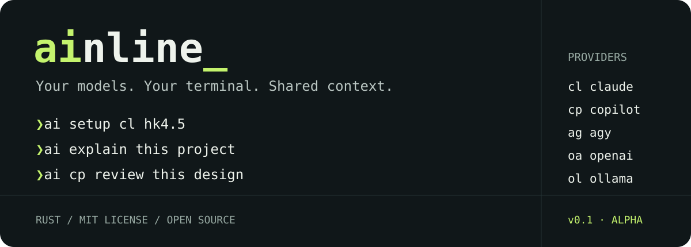

<p align="center">
  
</p>

<p align="center">
  <a href="https://github.com/PabloAlcoleaSesse/ainline/actions/workflows/ci.yml"></a>
  <a href="LICENSE"></a>
  
  
</p>

**`ai` adds shared project context to the model CLIs you already use.** Pick a
provider, use a short model code, or save your defaults and just ask.

```sh
ai setup cl hk4.5
ai explain this project
ai cp hk4.5 review this design
cat handler.go | ai oa find edge cases
```

Written in Rust. One selected provider per request. Your rules and working notes
follow you between models. Credentials stay with the provider CLIs.

[Quick start](#quick-start) · [Usage](docs/usage.md) · [Architecture](docs/architecture.md) · [Roadmap](ROADMAP.md) · [Contribute](CONTRIBUTING.md)

## Quick start

Install [Rust](https://rustup.rs/) 1.89+ and at least one supported provider CLI,
then authenticate that provider using its own instructions.

```sh
git clone https://github.com/PabloAlcoleaSesse/ainline.git
cd ainline
cargo install --path . --locked

ai status
ai setup cl hk4.5
ai what is this project about
```

The package is named **`ainline`**; the installed executable is **`ai`**. The package
is not published to crates.io. Source installation works today. Release automation now generates archives, checksums,
a Python-free shell installer for macOS/Linux, a Windows Python installer, and a Homebrew formula; downloads require a published release. See
[installation and uninstall instructions](docs/installation.md).

Before a real request, preview exactly what `ai` assembles:

```sh
ai cl hk4.5 --dry-run --no-git explain this project
```

## A small command surface

```text
ai [provider] [model-code] [flags] <message>
```

| What you want | Command |
| --- | --- |
| Run reusable instructions | `ai task review` |
| Inspect included context | `ai context explain --json` |
| Use saved defaults | `ai explain this error` |
| Choose a provider | `ai cp review this design` |
| Choose provider + model | `ai cl hk4.5 explain this function` |
| Use a full model ID | `ai cl --model claude-haiku-4-5-20251001 explain this` |
| Set your defaults | `ai setup cl hk4.5` |
| Set another provider's model | `ai config model oa default` |
| List model shortcuts | `ai models cl` |
| Skip project context | `ai ol --no-context explain ownership` |
| Attach specific files | `ai -f src/main.rs explain this function` |
| Include git diff | `ai --diff review my changes` |
| Copy output to clipboard | `ai -c generate email validation regex` |
| Generate shell completions | `ai completions zsh` |
| Forward a native option | `ai cl --provider-arg=--effort --provider-arg=high review this` |

| Provider | Short name | Example model code |
| --- | --- | --- |
| Claude Code | `cl` | `hk4.5`, `sn4.5`, `op4.5` |
| GitHub Copilot CLI | `cp` | `hk4.5` |
| Google Antigravity CLI (`agy`) | `ag` | `gp3.1` |
| OpenAI Codex CLI | `oa` / `codex` | Native Codex default |
| Ollama | `ol` | `qw2.5` |

Model codes are explicit, configurable mappings. They do not guarantee account
access or install models. Full provider names continue to work.

A recognized provider in the first argument selects it; otherwise the words are
the message for your default. Reserved administrative commands keep their usual
meaning. Use `ai -- ...` to make everything after `--` literal message text.
Flags go before the message. See the [full syntax and mappings](docs/usage.md).

## Your own `ai2`, `ai3`, or named agent

Save independent defaults and optional instructions in a profile:

```sh
ai profile create 2 cl hk4.5 --instructions "Review code. Focus on correctness and edge cases." --install
printf '%s\n' 'Explain briefly, with examples.' > explainer.md
ai profile create 3 ol qw2.5 --instructions-file ./explainer.md --install

# Shortcuts install beside ai.

ai2 review this endpoint
ai3 explain Rust lifetimes
ai2 oa give me a second opinion
ai2 status
```

Named profiles work too: `ai profile set reviewer cp hk4.5`, then
`ai --profile reviewer review this design`. No fixed set of numbered slots is
required. Profiles share project context; instructions are prepended to requests.
Explicit provider/model choices override saved defaults. See
[profiles](docs/usage.md#profiles-and-numbered-commands) for precedence, Windows
shortcuts, and configuration details.

## Context that stays with the project

```sh
ai context init
ai context rule style "Use typed errors and keep functions small"
ai context note "Migrating the login endpoint"
ai context rule preferences --local "Respond in Spanish"
```

```text
.ai/
├── .gitignore
├── session.json             # working notes, expires after 24 hours
└── rules/
    ├── style.md             # share with your team
    └── preferences.local.md # keep local
```

`ai` finds the nearest `.ai/` or `.git` marker, loads rules and live notes, detects
the stack, and adds a short Git summary. Expired notes are pruned on access.
Use `--no-git` to avoid Git subprocesses or `--no-context` to skip this collection.

Configuration lives in `~/.config/ai/config.yaml`; `AI_CONFIG_FILE` and
`XDG_CONFIG_HOME` are supported. Start with [config.example.yaml](config.example.yaml).

## Built for pipes and scripts

```sh
cat error.log | ai cp explain the failure
ai cl draft a migration plan | ai cp critique this plan
answer=$(ai ol --no-context "Explain ownership in one sentence")
```

stdout carries the response; stderr carries diagnostics. Provider failures keep
their exit codes. There is no implicit retry or fallback. Enable your shell's
`pipefail` when failure in an earlier pipeline stage should fail the pipeline.
Claude, Copilot, and Ollama stream response text. Codex returns its final answer;
Antigravity buffers and validates its structured response. Use `--no-stream` when you need stdout
to remain empty on provider failure; streaming can leave partial text on failure.

Requests default to a **300-second timeout** and **16 MiB combined output limit**.
Override with `--timeout 60 --max-output-bytes 1048576`. Timeout exits with 124;
Ctrl+C exits with 130. Child groups/jobs are cleaned up on exit.

## Version 1.0.0

The 1.0 release includes direct provider execution, profiles, reusable tasks and
context inspection. The current local suite
has **53 Rust tests**, including simulated providers, profiles, configuration migrations, default
selection, shorthand parsing, context persistence, and provider exit handling.
Automated tests use local fixtures. See the [compatibility report](docs/compatibility.md)
for installed-version checks and the separate opt-in live probe.

Known limits matter before you rely on it unattended:

- Live compatibility and minimum versions for all five providers still need
  systematic verification. Provider flags and model availability can change.
- Unix process groups and Windows Job Objects supervise children. Deliberately
  detached Unix processes can escape their group; this is not an isolation sandbox.
- Windows implementation and platform tests still need confirmation on Windows CI.
  Antigravity also retains its own five-minute native limit.
- Provider permissions, hooks, and local settings still apply. Antigravity's plan
  mode is not a sandbox, and native flags can alter provider behavior.
- The cross-platform workflow is configured; inspect its actual results before
  assuming a release works on every operating system.

A prior warm benchmark on macOS ARM64 measured **2.23 ms** median preparation with
`--no-git`, and **16.74 ms** with Git. These exclude model execution and predate the
latest defaults/alias work. Run `python3 scripts/benchmark.py` for your machine.
There is no blanket sub-15-ms performance guarantee.

## Development

```sh
cargo fmt --all --check
cargo test --locked --all-targets
cargo clippy --locked --all-targets -- -D warnings
cargo build --locked --release
```

Install missing lint tools with `rustup component add clippy rustfmt`.
See [CONTRIBUTING.md](CONTRIBUTING.md) for the development workflow and
[RELEASING.md](docs/RELEASING.md) for publication and release steps.

Useful contributions include provider compatibility reports, Windows testing,
process lifecycle improvements, and clearer docs. Read the [roadmap](ROADMAP.md),
open a focused issue, or send a small PR.

## License and community

[MIT](LICENSE). Contributions are welcome under the same license.
Please follow the [Code of Conduct](CODE_OF_CONDUCT.md). Report vulnerabilities
through the process in [SECURITY.md](SECURITY.md), without posting secrets publicly.

An independent community project; not affiliated with or endorsed by the provider
vendors. Provider subscriptions, terms, and usage charges apply separately.
# ainline

### Diagnose and share

```sh
ai doctor oa
ai --profile 2 doctor --json
ai profile export 2 --output reviewer.yaml
ai profile import reviewer.yaml --name reviewer
```

Doctor checks the selected executable and supported native authentication status
without a model request. Profile exports embed instructions; review them before
sharing. See [diagnostics and sharing](docs/usage.md#diagnostics) for limits and
provider coverage.
